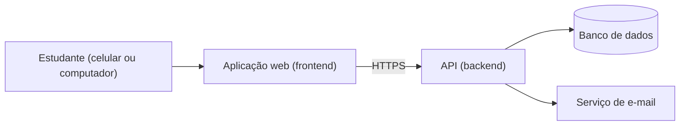
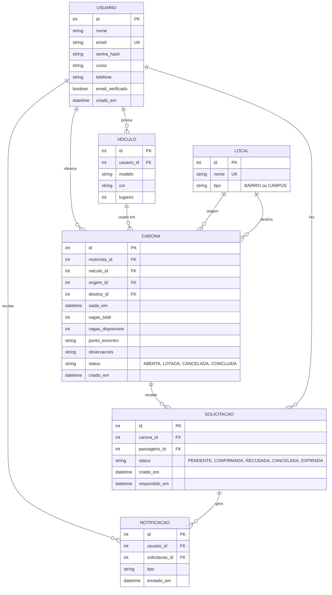

# Caroville

Plataforma de caronas para estudantes da Univille. Conecta alunos que **oferecem carona** com alunos que **precisam de transporte**, a partir de local de saída, destino, horário e número de vagas.

**Autores:** Lucas Felipe, Pedro Placidina
**Instituição:** Universidade da Região de Joinville - Univille

## Documentação técnica (MVP)

| # | Documento | Conteúdo |
|---|-----------|----------|
| 1 | [Requisitos funcionais, histórias de usuário e regras de negócio](docs/01-requisitos-funcionais.md) | RF, histórias com critérios de aceite BDD, RN |
| 2 | [Requisitos não funcionais](docs/02-requisitos-nao-funcionais.md) | RNF mensuráveis |
| 3 | [Protótipos de tela](docs/03-prototipos.md) | Telas no Figma ligadas às histórias |
| 4 | [ADRs](docs/adrs/) | Decisões de arquitetura |
| 5 | [Modelagem de dados (DER)](docs/05-modelagem-de-dados.md) | DER e dicionário de dados |

## Visão geral da arquitetura

## Escopo do MVP

Cadastro e login com e-mail institucional, oferta de carona, busca por saída/destino/horário, solicitação, aceite ou recusa, cancelamento e perfil com veículo.

Fora do escopo do MVP: pagamento ou rateio de custos, chat interno, mapa com rotas em tempo real e avaliações entre usuários.

# 5. Modelagem de Dados (DER)

## Dicionário resumido e restrições

| Tabela | Restrições principais |
|--------|-----------------------|
| USUARIO | `email` único e do domínio institucional (RN01) |
| VEICULO | `lugares` entre 2 e 8 |
| CARONA | `vagas_total` entre 1 e 6 (RN03); `vagas_disponiveis` entre 0 e `vagas_total`; origem diferente do destino |
| SOLICITACAO | Um passageiro só pode ter uma solicitação ativa (pendente ou confirmada) por carona (RN06) |
| NOTIFICACAO | `solicitacao_id` é opcional |

O telefone fica em USUARIO e só é mostrado quando existe uma solicitação confirmada entre as duas pessoas (RN10).
